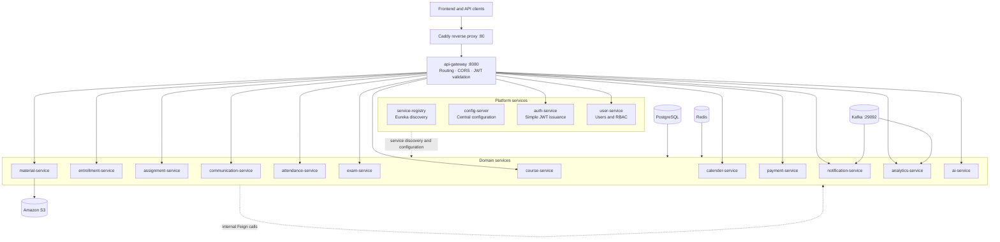

# Mentify Backend

<div align="center">

**Spring Boot microservices backend for the Mentify Learning Management System**

[](https://adoptium.net/temurin/releases/?version=17)
[](https://spring.io/projects/spring-boot)
[](#architecture-overview)
[](#security--rbac-model)
[](#event-driven-communication)
[](#amazon-s3)

</div>

Mentify is an AI-enabled Learning Management System backend built from independently deployable Spring Boot services. The platform combines centralized routing and configuration, Eureka discovery, simple RSA-signed JWT authentication, PostgreSQL persistence, Redis caching, Kafka events, and Amazon S3 object storage.

> **Current deployment model:** the backend runs as Docker containers on one AWS EC2 instance for the cost-conscious academic/demo environment. The separate `SENG-34213/infra` repository owns EC2 infrastructure and reverse-proxy operations.

## At a glance

<table>
<tr>
<td width="33%" valign="top">

### ☕ Runtime

**Java 17 + Spring Boot 3.x**

The backend is organized as a Maven multi-module Spring Cloud application.

</td>
<td width="33%" valign="top">

### 🧩 Services

**Platform + domain microservices**

Gateway, discovery, configuration, authentication, learning, communication, analytics, payment, and AI services.

</td>
<td width="33%" valign="top">

### 🐳 Packaging

**One reusable Docker image**

`holins/mentify-backend:<git-sha>` contains all service JARs and Compose selects the active service.

</td>
</tr>
<tr>
<td width="33%" valign="top">

### 🔐 Security

**Simple RSA-signed JWT**

`auth-service` issues access/refresh tokens. Keycloak is not required by the current runtime.

</td>
<td width="33%" valign="top">

### 📨 Messaging

**Apache Kafka 3.9.1**

Notification and analytics workflows use asynchronous events through Kafka topics.

</td>
<td width="33%" valign="top">

### 🗄️ Data

**PostgreSQL + Redis**

PostgreSQL stores transactional data. Redis provides caching, locks, and short-lived state.

</td>
</tr>
<tr>
<td width="33%" valign="top">

### ☁️ Object storage

**Amazon S3**

Learning materials and application files are stored outside the EC2 container filesystem.

</td>
<td width="33%" valign="top">

### 🚀 Delivery

**GitHub Actions → Docker Hub → EC2**

Successful `main` builds publish an immutable image and deploy it automatically to EC2.

</td>
<td width="33%" valign="top">

### 💰 Deployment model

**Cost-conscious single EC2 host**

Backend containers run on one EC2 instance with Docker Compose for the academic/demo environment.

</td>
</tr>
</table>

> **Production network:** `mentify-prod_backend`<br>
> **Backend image:** `holins/mentify-backend:<git-sha>`<br>
> **Public API:** `http://<EC2_HOST>/api`<br>
> **Health check:** `http://<EC2_HOST>/actuator/health`

## Contents

- [Architecture Overview](#architecture-overview)
- [Tech Stack](#tech-stack--ecosystem)
- [Microservices Catalog](#microservices-catalog)
- [Security and RBAC](#security--rbac-model)
- [AI Features](#ai--intelligent-features)
- [Event-Driven Communication](#event-driven-communication)
- [Amazon S3](#amazon-s3)
- [Repository Structure](#repository-structure)
- [Local Development](#getting-started)
- [Production Deployment](#production-deployment)
- [Configuration and Secrets](#configuration-and-secrets)
- [Testing and Quality Gates](#testing-and-quality-gates)
- [Operations and Troubleshooting](#operations-and-troubleshooting)
- [Documentation](#documentation-index)

---

## 🏗️ Architecture Overview

Mentify follows a **Spring Cloud microservices** pattern. The gateway is the public backend entry point; service discovery and configuration are provided by the platform services; domain services own their business data and workflows; Kafka handles asynchronous events.

### In-Depth System Design



The diagram shows every backend service in this repository. All service-to-service communication remains private to the Docker network; Caddy and the gateway are the public request path.

---

## 🛠️ Tech Stack & Ecosystem

### Core Frameworks
*   **Java 17 (LTS)**: Core programming language.
*   **Spring Boot 3.x**: Service foundation.
*   **Spring Cloud (2022.x/2023.x)**:
    *   **Netflix Eureka**: Service Discovery & Registry.
    *   **Spring Cloud Gateway**: Centralized entry point & Security filter (WebFlux).
    *   **Spring Cloud Config**: Centralized externalized configuration management.
    *   **Spring Cloud OpenFeign**: Declarative REST client for inter-service communication.

### Data, messaging, and storage
*   **PostgreSQL 14**: Transactional relational data with service-specific databases and Flyway migrations.
*   **Redis 7.4**: Caching, locks, idempotency, and short-lived state.
*   **Apache Kafka 3.9.1**: Event streaming for decoupled notification and analytics workflows.
*   **Amazon S3**: Durable storage for learning materials and application attachments.
*   **Flyway**: Database versioning and migrations.

### Security & AI
*   **Simple JWT authentication**: `auth-service` issues RSA-signed access and refresh tokens. Keycloak is not used in the current runtime.
*   **OpenAI/API integrations**: Power intelligent tutor chat, grounded data analysis, and quiz generation.
*   **Apache POI / PDFBox**: For document text extraction and content ingestion.

---

## 📂 Microservices Catalog

Mentify is composed of several specialized services, each responsible for a specific domain:

| Service | Responsibility | Data / integrations |
| :--- | :--- | :--- |
| **`api-gateway`** | Central API entry point, routing, CORS, and JWT resource-server validation. | Eureka, Config Server |
| **`service-registry`** | Eureka service registration and discovery. | - |
| **`config-server`** | Serves environment-specific and service configuration. | Native configuration |
| **`auth-service`** | Login, registration, password flows, token issuance, and refresh handling. | PostgreSQL, RSA JWT keys |
| **`user-service`** | User profiles, roles, administration, and user workflows. | PostgreSQL, email |
| **`course-service`** | Courses, modules, lessons, and course structure. | PostgreSQL |
| **`entrollment-service`** | Student enrolment and student-course relationships. | PostgreSQL |
| **`assignment-service`** | Assignments, submissions, grading, and quizzes. | PostgreSQL |
| **`communication-service`** | Messaging, groups, announcements, and communication features. | PostgreSQL |
| **`attendance-service`** | Attendance sessions, records, and reporting. | PostgreSQL, calendar |
| **`exam-service`** | Exams, questions, attempts, grades, and exam workflows. | PostgreSQL |
| **`material-service`** | Material metadata and upload/download workflows. | PostgreSQL, Amazon S3 |
| **`calender-service`** | Calendar events and cross-service projections. | PostgreSQL |
| **`payment-service`** | Payment-provider integration and payment workflows. | PostgreSQL, Stripe |
| **`notification-service`** | Email, SMS, and in-app notification processing. | PostgreSQL, Kafka, SMTP |
| **`analytics-service`** | Analytics, summaries, and reporting data. | PostgreSQL |
| **`ai-service`** | AI assistant, grounded tools, document processing, and AI learning features. | PostgreSQL, OpenAI/API, PDFBox, Apache POI |

> Ports are environment-driven. In production, services communicate through Docker service names and are not exposed directly to the internet. The gateway is the public backend entry point on port `8080` inside the Docker network.

---

## 🔒 Security & RBAC Model

Mentify implements a multi-layered security architecture:

1.  **Gateway Security**: `api-gateway` uses Spring Security WebFlux to validate JWT signatures issued by `auth-service`. It handles CORS and public/private route filtering.
2.  **Service-Level Security**: Every microservice leverages a shared `SecurityConfig` (from `common-lib`) which:
    *   Decodes Mentify JWT claims.
    *   Maps token roles to Spring Security `GrantedAuthority`.
    *   Enforces method-level security using `@PreAuthorize("hasRole('TEACHER')")`.
3.  **Inter-Service Auth**: Internal communication via Feign clients carries the user's JWT token, ensuring that the security context is propagated across service boundaries.
4.  **Resource Ownership**: Specialized authorization services (e.g., `MaterialAuthorizationServiceImpl`) verify that users only access resources they own or are enrolled in.

---

## ☁️ Amazon S3

`material-service` uses Amazon S3 for durable object storage instead of relying on the EC2 container filesystem. PostgreSQL stores the metadata and authorization relationship; S3 stores the object content.

Typical responsibilities include:

- learning-material uploads and downloads;
- assignment or communication attachments where configured;
- controlled or presigned download URLs;
- expiration for temporary download links;
- keeping files safe when containers are recreated.

Production rules:

- keep the bucket private by default;
- use an EC2 IAM role with least-privilege permissions where possible;
- enable server-side encryption and lifecycle rules;
- monitor storage, requests, and data-transfer costs;
- never commit AWS access keys or place them in a Docker image.

Relevant settings include `AWS_REGION`, `MATERIAL_S3_BUCKET`, `MATERIAL_S3_ENDPOINT`, and `MATERIAL_DOWNLOAD_URL_EXPIRATION`.

---

## 🤖 AI & Intelligent Features

The **AI Service** provides a "Grounded Tool" architecture:
*   **Tutor Chat**: An interactive chatbot for teachers and admins that uses context-aware conversation history.
*   **Grounded Tool Analysis**: Instead of raw LLM generation, the AI uses authorized backend tools (e.g., `TodayQuizPerformanceTool` and `UpcomingCalendarEventsTool`) to fetch real-time data from other services before summarizing it. Calendar insights use the upcoming events visible to the authenticated user.
*   **AI Quiz Generation**: Automatically generates MCQ quizzes based on course materials and lessons.
*   **Content Guardrails**: All AI interactions pass through a `UsageGuard` and `ContentGuard` to ensure policy compliance and quota management.

---

## 📨 Event-Driven Communication

Mentify uses an **AOP-driven event system** to maintain service decoupling:

*   **Producer Side**: Services annotate controller methods with `@NotifyOnSuccess(type = "COURSE_CREATED", ...)`. A shared Aspect (`NotificationOnSuccessAspect`) in `common-lib` intercepts the successful response and publishes a `NotificationEvent` to Kafka.
*   **Message Broker**: Apache Kafka acts as the distributed event bus, ensuring high availability and persistence of events.
*   **Consumer Side**: The `notification-service` consumes events from the `mentify.notification-events` topic and routes them to the appropriate channel (Email via SMTP, SMS, or in-app notifications).

### Kafka configuration

Production containers use the internal broker address `kafka:29092`. Relevant environment variables include:

```text
KAFKA_BOOTSTRAP_SERVERS
NOTIFICATION_KAFKA_ENABLED
NOTIFICATION_KAFKA_TOPIC
```

---

## 🚀 Getting Started

### Prerequisites
*   **Java 17+**
*   **Docker & Docker Compose**
*   **Maven 3.8+**

### 1. Environment Configuration
Clone the repository and initialize a local environment file:
```bash
git clone https://github.com/SENG-34213/Mentify-backend.git
cd Mentify-backend
cp .env.example .env
```
Use development-only values in `.env`. Never copy `.env.prod` into the repository.

### 2. Start local dependencies

```bash
docker compose up -d
docker compose ps
```

The local Compose file provides the configured PostgreSQL, Redis, Kafka, PgAdmin, and Mailpit dependencies.

### 3. Build and run services

Build the complete multi-module project:

```bash
mvn -B clean verify
```

When running services individually, start them in this order:

1. `service-registry` — verify `http://localhost:8761`.
2. `config-server` — verify `http://localhost:8888`.
3. `auth-service` and the services required by the selected feature.
4. `api-gateway` — the local API entry point.
5. Remaining business services.

Run one service with its required modules:

```bash
mvn -pl services/user-service -am spring-boot:run
```

---

## 🚀 Production Deployment

The backend is packaged into one reusable Docker image containing all service JARs:

```text
holins/mentify-backend:<git-sha>
```

Compose selects the service process with `SERVICE_JAR`, such as `auth-service.jar` or `course-service.jar`.

### CI/CD flow

The workflow in `.github/workflows/ci-cd.yaml` runs validation, compilation, unit tests, coverage, and configured integration tests. On a successful push to `main`, it:

1. builds `docker/Dockerfile`;
2. pushes the commit-SHA and `latest` images to Docker Hub;
3. connects to EC2 with `EC2_SSH_PRIVATE_KEY`;
4. copies Compose, Caddy, deployment metadata, and database initialization files;
5. logs in to Docker Hub on EC2;
6. pulls the exact commit-tagged image;
7. recreates the backend containers;
8. verifies `/actuator/health`.

If required checks fail, the image is not published and EC2 is not deployed.

### Required GitHub configuration

```text
DOCKERHUB_USERNAME
DOCKERHUB_TOKEN
EC2_HOST
EC2_USERNAME
EC2_SSH_PRIVATE_KEY
```

Repository variable:

```text
DOCKERHUB_IMAGE=holins/mentify-backend
```

### EC2 checks

```bash
ssh -i ~/Downloads/mentify-ec2-key-2.pem ubuntu@<EC2_HOST>
cd /opt/mentify

docker compose \
  --env-file .env.prod \
  --env-file .deploy.env \
  -f docker-compose.prod.yml \
  ps

curl -i http://127.0.0.1/actuator/health
```

Expected response:

```json
{"status":"UP"}
```

The frontend containers are deployed separately from `/opt/mentify/frontend` and share the `mentify-prod_backend` Docker network.

---

## 🔐 Configuration and Secrets

Use `.env.example` and `.env.prod.example` as templates only. The real production file exists only on EC2:

```text
/opt/mentify/.env.prod
```

Protect it with:

```bash
chmod 600 /opt/mentify/.env.prod
```

Never commit private JWT keys, database/Redis/Kafka passwords, Docker Hub tokens, EC2 private keys, SMTP/Stripe/OpenAI credentials, or AWS access keys.

Inside Docker, use service names instead of `localhost`:

| Dependency | Container address |
|---|---|
| PostgreSQL | `postgres` |
| Redis | `redis` |
| Kafka | `kafka:29092` |
| Eureka | `http://service-registry:8761/eureka/` |
| Config Server | `http://config-server:8888` |
| Auth Service | `http://auth-service:8085` |
| User Service | `http://user-service:8081` |

`localhost` refers to the current process/container, not another Compose service.

---

## ✅ Testing and Quality Gates

```text
Lint / validate → Compile / build → Unit tests + JaCoCo
       → Integration tests → CI summary
       → Docker build/push and EC2 deployment on main
```

Useful local commands:

```bash
mvn -B validate
mvn -B compile -DskipTests
mvn -B test
mvn -B verify
```

CI publishes service-level test and coverage artifacts. Integration tests use isolated PostgreSQL containers and CI-specific configuration rather than the production database.

---

## 🧰 Operations and Troubleshooting

### Check all containers

```bash
cd /opt/mentify
docker compose \
  --env-file .env.prod \
  --env-file .deploy.env \
  -f docker-compose.prod.yml \
  ps -a
```

### View logs

```bash
docker compose \
  --env-file .env.prod \
  --env-file .deploy.env \
  -f docker-compose.prod.yml \
  logs --tail=100 api-gateway auth-service course-service
```

### Inspect a failing health check

```bash
docker inspect mentify-prod-course-service-1 \
  --format '{{json .State.Health}}'

docker compose \
  --env-file .env.prod \
  --env-file .deploy.env \
  -f docker-compose.prod.yml \
  logs --tail=200 course-service
```

### Common causes of `401 Unauthorized`

1. Missing `Authorization: Bearer <accessToken>`.
2. Expired token or a token signed with a different RSA key.
3. `AUTH_ISSUER_URI` does not match the JWT `iss` claim.
4. The service cannot reach the internal JWK endpoint.
5. The token role does not satisfy the endpoint rule.
6. EC2 is running an old image or stale configuration.

Verify deployed JWT variables:

```bash
docker inspect mentify-prod-entrollment-service-1 \
  --format '{{range .Config.Env}}{{println .}}{{end}}' \
  | grep -E 'AUTH_ISSUER_URI|AUTH_JWK_SET_URI|SPRING_SECURITY_OAUTH2_RESOURCESERVER'
```

### EC2 resource checks

```bash
free -h
df -h
docker system df
docker stats --no-stream
```

The single-EC2 deployment has no high availability. Monitor memory, swap, disk usage, Docker volumes, PostgreSQL, Redis, Kafka, and S3 backups.

> **Production safety:** never run `docker compose down -v`; the `-v` option can delete persistent database data.

---

## 🛠️ Development Guidelines

### Project Structure
```text
.
├── pom.xml                         # Maven multi-module parent
├── common-lib/                     # Shared DTOs, security, errors, and utilities
├── cloud/
│   ├── api-gateway/
│   ├── config-server/
│   └── service-registry/
├── services/                       # Domain microservices
│   ├── ai-service/
│   ├── analytics-service/
│   ├── assignment-service/
│   ├── attendance-service/
│   ├── auth-service/
│   ├── calender-service/
│   ├── communication-service/
│   ├── course-service/
│   ├── entrollment-service/
│   ├── exam-service/
│   ├── material-service/
│   ├── notification-service/
│   ├── payment-service/
│   └── user-service/
├── docker/
│   ├── Dockerfile                  # One reusable runtime image
│   └── postgres/init/              # Initial service-database creation
├── docker-compose.yml              # Local dependencies
├── docker-compose.prod.yml         # EC2 production stack
├── Caddyfile                       # Local/backend proxy configuration
├── .env.example                    # Safe local template
├── .env.prod.example               # Safe production template
├── .github/workflows/ci-cd.yaml    # CI, image publishing, EC2 deployment
└── docs/                           # Setup, testing, auth, and feature guides
```

### Useful Commands
*   **Build Project**: `mvn -B clean verify`
*   **Build without tests**: `mvn -B clean package -DskipTests`
*   **Run one service**: `mvn -pl services/user-service -am spring-boot:run`
*   **Check health**: services expose Actuator endpoints when enabled by their profile.

---

## 📖 Documentation Index

For deeper technical details, refer to the following guides:
*   📘 [Project Setup & Installation](docs/PROJECT_SETUP.md)
*   🔐 JWT authentication is implemented by `services/auth-service`.
*   📡 [Kafka & Notification System Guide](docs/NOTIFICATION_SERVICE.md)
*   🧪 [Testing Standards & Quality Gates](docs/testing/README.md)
*   🔄 [Authentication & Session Flows](docs/AUTHENTICATION_SESSION_FLOW.md)

---

## ⚖️ License

This project is **Proprietary and Confidential**. All rights reserved. Unauthorized copying or distribution of this software is strictly prohibited.
